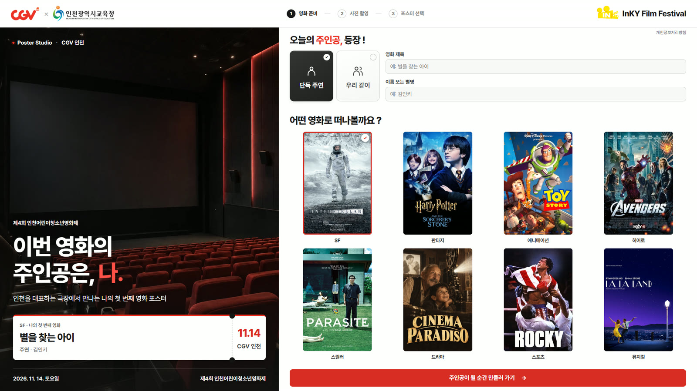
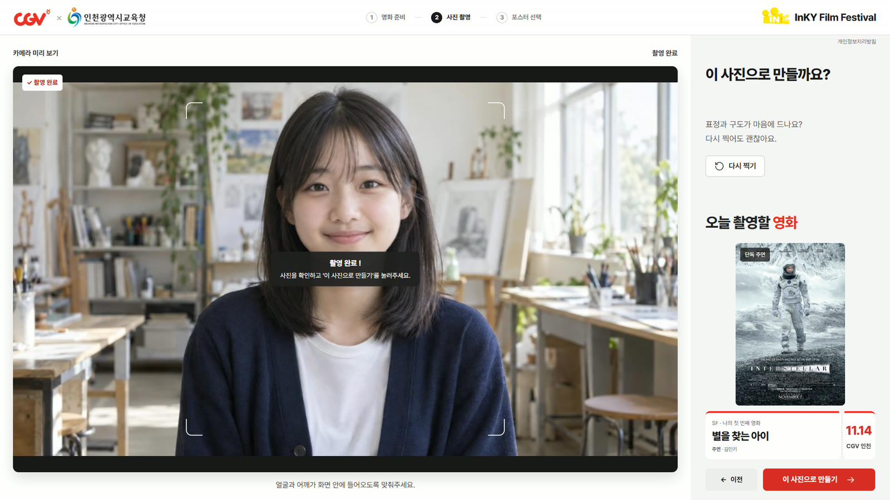
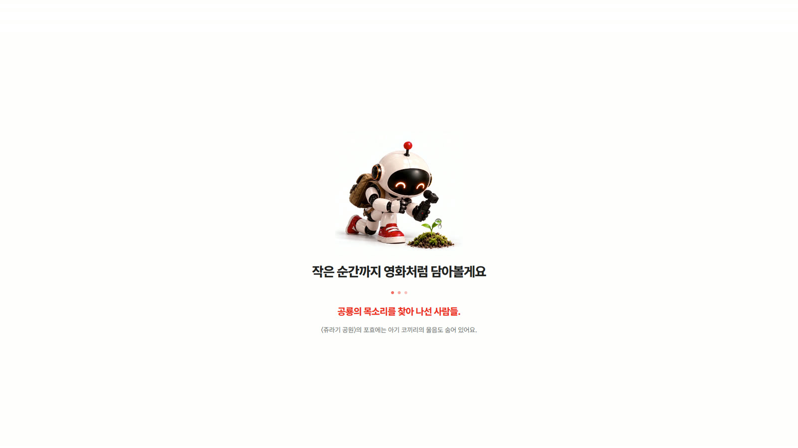
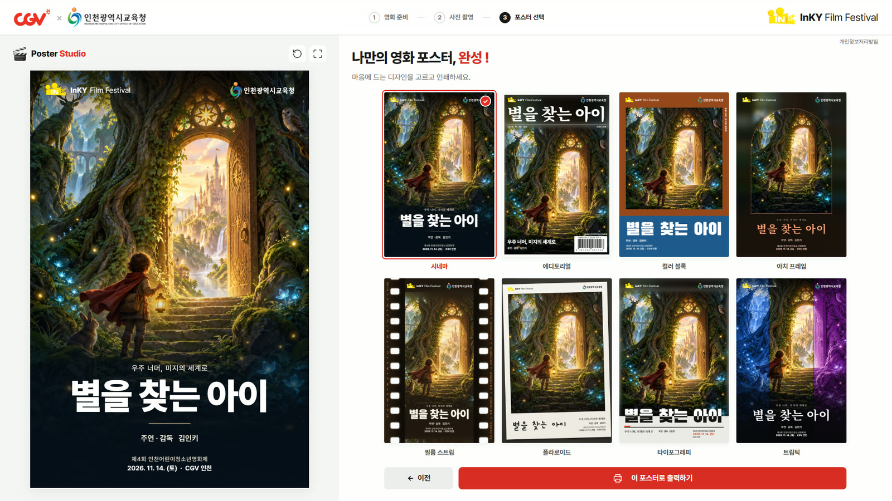
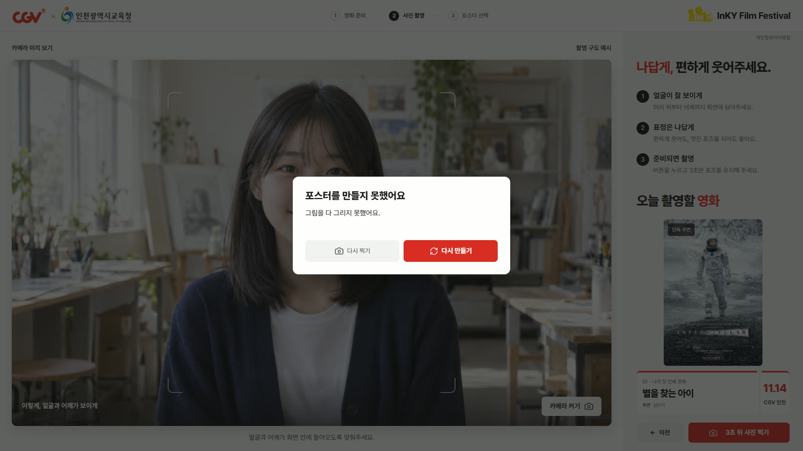

# Poster Studio 부스 운영 설명서 — 운영자용

> 2026-10-19 화면 기준(휴대폰 새 흐름 · 포스터 8종 새 디자인). [확정 대기] 표시는 화면·장비가 정해지면 채운다. 인쇄용 A4 PDF는 이 글에서 만든다.

제4회 인천어린이청소년영화제(2026.11.14. 토, 10:30~15:00, CGV 인천) «InKY 놀이터»의 Poster Studio 부스입니다.
아이가 영화 제목을 정하고 사진을 찍으면, AI가 그 사진으로 영화 장면 그림을 그리고, 화면에서 포스터 8가지 중 하나를 골라 4×6 사진 용지로 인쇄해 가져갑니다.

## 1. 한눈에

| 항목 | 내용 |
|---|---|
| 주소 | **poster.edutogether.kr** (크롬으로 엽니다) |
| 한 명 걸리는 시간 | 입력 1분 · 촬영 30초 · AI 그리기 약 1분(길면 2분 30초) · 고르기와 인쇄 1~2분 |
| 아이가 가져가는 것 | 4×6 포스터 한 장 |
| 노트북 | 6대 = 쓰는 4대 + 바꿔 쓸 2대 |
| 프린터 | 3대(충전기를 꽂은 채로 인쇄) |
| 인터넷 | 대여 와이파이 2개 + 휴대폰 핫스팟 1개 |
| 개인정보 | 사진은 AI 그림을 만드는 데만 쓰고 저장하지 않습니다. 이름은 노트북 밖으로 나가지 않습니다(7번) |

## 2. 준비물

- 노트북 6대와 충전기, 멀티탭
- 프린터 3대와 충전기, 4×6 사진 용지(넉넉히 — 1명 1장 + 예비)
- 대여 와이파이 2개, 휴대폰 핫스팟 1개
- 부스 코드(켜는 경우에만 — 켤지는 장학사님과 정합니다. 별지에 적고 이 설명서에는 적지 않습니다)
- 이 설명서 인쇄본

## 3. 설치(행사 시작 30분 전까지)

1. **전원**: 노트북·프린터 모두 충전기를 꽂습니다. 🔴 프린터는 배터리만으로는 30장쯤에서 멈춥니다. 충전기를 꽂은 채로 인쇄하면 괜찮습니다.
2. **인터넷**: 노트북을 와이파이 3개에 고르게 나눕니다(한 와이파이에 2대씩). 한 곳에 몰리면 그 노트북들만 «이 네트워크에서 요청이 너무 많이 몰렸습니다»가 뜰 수 있습니다.
3. **주소 열기**: 크롬에서 **poster.edutogether.kr**을 엽니다.
4. **부스 코드(켜는 경우에만)**: 처음 «이 사진으로 포스터 만들기»를 누르면 «부스 코드를 넣어 주세요» 창이 뜹니다. 별지의 코드를 넣고 «확인»을 누르면 그 노트북이 기억합니다(시험 촬영 때 한 번 넣어 두면 됩니다). 부스 코드를 켜지 않으면 이 창은 뜨지 않습니다.
5. **소리**: 노트북 소리를 켜고, 부스 소음에 맞춰 적당히 키웁니다(촬영 화면의 예시 영상에 소리가 있습니다).
6. **카메라**: «카메라 켜기»를 처음 누르면 크롬이 카메라를 써도 되는지 묻습니다. **허용**을 누릅니다.
7. **프린터**: [확정 대기 — 리허설에서 정합니다] 크롬 인쇄 창에서 프린터를 고르고, 용지 4×6(10×15cm)·여백 없음·배율 기본(100%)·머리글과 바닥글 끄기로 맞춥니다.
8. **시험**: 노트북마다 운영자 사진으로 한 번 끝까지 해 봅니다(촬영 → 생성 → 인쇄).

## 4. 아이 한 명 진행 순서

화면 위쪽에 ① 영화 준비 ② 사진 촬영 ③ 포스터 선택 세 단계가 보입니다.

**① 영화 준비**
- «단독 주연»(혼자) 또는 «우리 같이»(여럿)를 고릅니다.
- 영화 제목을 적습니다. 비우면 예시 제목으로 만들어집니다.
- 혼자면 이름, 여럿이면 단체 이름과 출연진 이름을 적습니다. 별명도 괜찮습니다.
- 장르 8가지 중 하나를 고르고 «주인공이 될 순간 만들러 가기»를 누릅니다.

**② 사진 촬영**
- 예시 영상을 함께 보며 «이렇게 서면 돼요»라고 알려 줍니다.
- «카메라 켜기» → 얼굴과 어깨가 화면 안에 들어오게 자리를 잡습니다. 여럿이면 모두의 얼굴이 보이게 모입니다.
- «3초 뒤 사진 찍기» → 숫자 3·2·1 뒤에 찍힙니다.
- 마음에 들면 «이 사진으로 만들기», 아니면 «다시 찍기».

**③ 기다리기와 포스터 고르기**
- AI가 그리는 동안 로딩 화면이 나옵니다(약 1분). 다시 누르지 말고 기다립니다.

- 포스터 8가지가 나오면 아이가 마음에 드는 것을 고릅니다.
- «이 포스터로 출력하기» → 인쇄 창에서 **인쇄**를 누릅니다.

- 🔴 인쇄 창에서 «PDF로 저장»을 고르지 않습니다. 아이 얼굴과 이름이 든 파일이 노트북에 남습니다.

**아이에게 하는 말(예)**
- «오늘 영화의 주인공은 너야 ! 영화 제목을 지어 볼까 ?»
- «화면을 보면서 편하게 웃어 줘. 3초 뒤에 찍혀 !»
- «AI가 너를 영화 장면으로 그리고 있어. 1분만 기다려 줘.»

## 5. 이럴 때는

| 화면에 보이는 것 | 할 일 |
|---|---|
| «AI 서버 연결을 확인할 수 없습니다» | 와이파이 연결을 확인합니다. 계속되면 다른 와이파이 노트북으로 옮깁니다 |
| 로딩 화면이 1분 넘게 계속됨 | 다시 누르지 말고 기다립니다. 2분 30초가 지나면 저절로 안내가 뜹니다 |
| «포스터를 만들지 못했어요» — 그림을 다 그리지 못했어요 | «다시 만들기»를 누릅니다. 같은 사진으로 3번 안 되면 «다시 찍기» |
| «포스터를 만들지 못했어요» — AI 안전 기준에 걸렸어요 | «제목 · 문구 고치기»로 제목을 바꾸거나 «다시 찍기» |
| «포스터를 만들지 못했어요» — 이 사진으로는 더 만들 수 없어요 | «다시 찍기» 또는 «처음으로» |
| «포스터를 만들지 못했어요» — 인터넷 연결이 끊겼어요 | 다른 와이파이·핫스팟으로 바꿉니다. 연결되면 «다시 만들기»가 켜집니다(사진은 그대로) |
| «포스터를 만들지 못했어요» — 지금은 만들 수 없어요 | 현장에서 풀 수 없습니다. 바로 담당자에게 알립니다 |
| «부스 코드를 넣어 주세요» | 별지의 부스 코드를 넣고 «확인». 맞으면 같은 사진으로 다시 만듭니다. «취소»는 탭을 닫거나(브라우저가 막으면) 처음 화면으로 돌아갑니다 — 찍은 사진은 버려지니 행사 노트북에서는 누르지 마세요 |
| «지금 여러 부스에서 요청이 몰려 있습니다» | 몇 분(길면 10분) 기다렸다 다시 합니다. 모든 노트북이 같이 겪습니다. 자주 뜨면 담당자에게 알립니다 |
| «이 네트워크에서 요청이 너무 많이 몰렸습니다» | 그 노트북들이 한 와이파이에 몰려 있는지 보고, 다른 와이파이로 옮깁니다 |
| «지금 요청이 몰려 잠시 대기가 필요합니다» | 10~20초 뒤 다시 합니다 |
| «이 사진으로는 (재)생성 횟수를 모두 사용했어요» | 정상입니다. 다시 찍으면 새 사진으로 만들 수 있습니다 |
| «오늘의 생성 한도에 도달했습니다» | 현장에서 풀 수 없습니다. 바로 담당자에게 알립니다 |
| 카메라가 안 켜짐 | 크롬 주소창 왼쪽 자물쇠 → 카메라 «허용». 안 되면 예비 노트북으로 바꿉니다 |
| 프린터가 안 나옴 | 전원(충전기)·용지·연결을 봅니다. 안 되면 예비 프린터로 보냅니다. 노트북은 다음 아이를 계속 받아도 됩니다 |
| 화면이 멈춤·이상함 | 크롬을 새로 고칩니다(F5). 그래도 안 되면 크롬을 닫았다 다시 엽니다 |

## 6. 휴대폰으로 볼 때(물어보면)

공개 주소(poster.edutogether.kr)를 휴대폰으로 열면 휴대폰에 맞춘 화면이 나옵니다. 첫 화면 사진을 누르면 영화 준비로 넘어가고, 촬영은 가운데 빨간 카메라 단추, 포스터는 옆으로 밀거나 양쪽 화살표로 넘겨 고른 뒤 인쇄 대신 «내 휴대폰에 저장»을 누릅니다. 행사 날 실제 촬영과 인쇄는 부스 노트북에서만 합니다.

## 7. 끝나고

- 크롬을 닫습니다. 사진은 노트북에 저장되지 않습니다.
- 남은 용지와 프린터를 챙깁니다.
- 혹시 인쇄 창에서 파일로 저장한 것이 있으면 담당 장학사께 알립니다(2026-12-31까지 보관 후 삭제).

## 8. 개인정보(물어보면 이렇게 답합니다)

- 사진은 AI 그림을 만들기 위해 OpenAI(미국) 서버로 보내지고, 그림을 만든 뒤 저장하지 않습니다.
- 아이 이름·단체 이름·출연진 이름은 서버로 보내지 않습니다. 노트북 화면에서 포스터 글자를 만드는 데만 씁니다.
- 서버에는 이용 횟수를 세는 숫자와 사진의 지문값(사진 자체가 아닌 짧은 암호값)만 남고, 30일 뒤 지워집니다.
- 자세한 내용은 화면 아래 «개인정보처리방침»에 있습니다.

## 9. 연락처

| 누구 | 연락처 |
|---|---|
| 현장 책임 | [확정 대기] |
| 기술 담당 | [확정 대기] |
