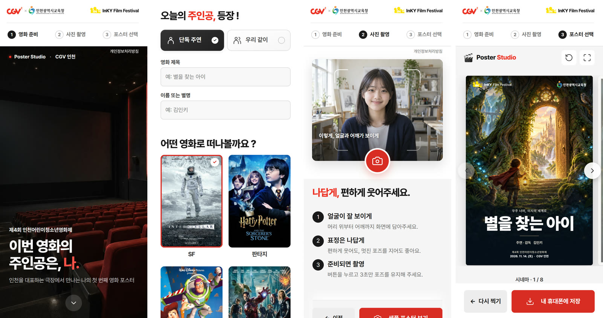

# Poster Studio 안내 — 선생님용

> 2026-10-19 화면 기준(휴대폰 새 흐름 · 포스터 8종 새 디자인). 인쇄용 A4 PDF는 이 글에서 만든다.

## 어떤 부스인가요

제4회 인천어린이청소년영화제 «InKY 놀이터»의 Poster Studio에서는 학생이 **나만의 영화 포스터**를 만듭니다.
영화 제목을 짓고 사진을 찍으면, AI가 그 사진으로 영화 장면 그림을 그립니다. 학생은 포스터 8가지 중 하나를 골라 4×6 사진 용지로 인쇄해 가져갑니다.

- 언제·어디: 2026년 11월 14일(토) 10:30~15:00, CGV 인천
- 걸리는 시간: 한 명 약 3~4분(줄을 서는 시간 제외)
- 혼자 또는 여럿이 함께: «단독 주연» 또는 «우리 같이»를 고릅니다. 여럿이면 모두의 얼굴이 화면에 보이게 모입니다.

## 학생이 하는 것

1. **영화 준비**: 영화 제목, 이름(별명도 됩니다), 장르(SF·판타지·애니메이션·히어로 등 8가지)를 정합니다.
2. **사진 촬영**: 화면의 예시를 보고 자리를 잡은 뒤, 3초 뒤에 찍힙니다. 마음에 들지 않으면 다시 찍을 수 있습니다.
3. **포스터 고르기**: AI가 약 1분 동안 그린 뒤 포스터 8가지가 나오고, 하나를 골라 인쇄합니다.

## 휴대폰으로 미리 보기

poster.edutogether.kr을 휴대폰으로 열면 휴대폰에 맞춘 화면으로 흐름을 미리 볼 수 있습니다. 첫 화면 사진을 누르면 영화 준비로 넘어가고, 촬영 화면의 빨간 카메라 단추, 옆으로 밀거나 양쪽 화살표로 넘겨 고르는 포스터, «내 휴대폰에 저장»이 차례로 나옵니다. 행사 날 실제 촬영과 인쇄는 부스 노트북에서 합니다.

## 미리 알려 주시면 좋은 것

- 영화 제목을 미리 생각해 오면 빨리 끝납니다(비워 두면 예시 제목으로 만들어집니다).
- 얼굴이 잘 보여야 그림이 잘 나옵니다. 모자나 마스크는 잠깐 벗는 것이 좋습니다.

## 개인정보

- 이 부스는 교육청이 미리 서면 동의를 받은 학생만 참여합니다.
- 사진은 AI 그림을 만들기 위해 OpenAI(미국) 서버로 보내지고, 그림을 만든 뒤 **저장하지 않습니다.**
- 학생 이름·단체 이름·출연진 이름은 **서버로 보내지 않습니다.** 노트북 화면에서 포스터 글자를 만드는 데만 씁니다.
- 서버에는 이용 횟수를 세는 숫자와 사진의 지문값(사진 자체가 아닌 짧은 암호값)만 남고, 30일 뒤 자동으로 지워집니다.
- 자세한 내용: poster.edutogether.kr 화면 아래 «개인정보처리방침»
